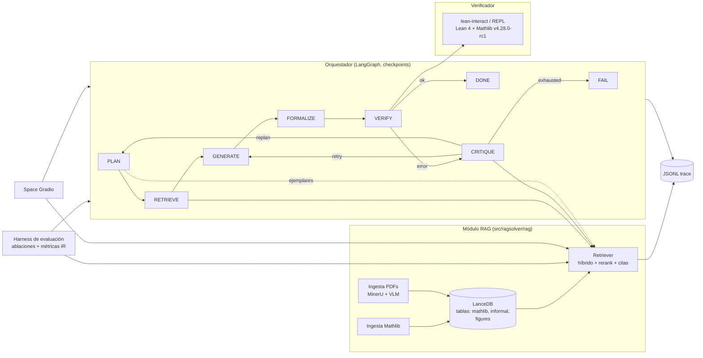

# Plan de acción — Módulo de Embeddings/RAG de RagSolver

> Documento de diseño y plan de ejecución para el agente implementador.
> Proyecto: *Sistema multiagente de IA generativa para resolución de problemas complejos mediante cadenas de razonamiento y verificación formal de teoremas* (UPTC, curso de IA, 13 semanas).
> Fecha: 2026-09-18. Idioma de trabajo interno: español; código, prompts, metadatos y reporte final en inglés.

---

## 0. Cómo usar este documento

- Es un plan **por fases, listo para ejecutar**. Cada fase tiene: objetivo, entradas, tareas numeradas, artefactos de salida, criterios de aceptación medibles y plan B. No pases a la siguiente fase sin cumplir los criterios de aceptación.
- **No sobre-ingeniería.** Regla: si algo no está en este plan y no lo pide un criterio de aceptación, no se construye. Nada de abstracciones con una sola implementación, ni frameworks de retriever encima de la base vectorial, ni fábricas de config.
- Cada decisión que te desvíe de este plan se registra en `docs/DECISIONS.md` (fecha, decisión, alternativa descartada, motivo, evidencia).
- Todas las versiones (Lean, Mathlib, modelos, parser, índice) se fijan en un único `configs/versions.yaml` y se copian a cada registro JSONL de ejecución (RNF-2).
- El código del módulo RAG vive en `src/ragsolver/rag/`. Nada del RAG debe importar nada de los agentes; los agentes importan el RAG.

---

## 1. Análisis del proyecto y dónde encaja el RAG

### 1.1 Objetivo del sistema completo (según la propuesta)

Resolver problemas matemáticos de nivel olimpiada con un grafo de agentes (Planificador → Recuperador → Generador → Autoformalizador → Verificador → Crítico) donde **la única fuente de verdad es el kernel de Lean 4 + Mathlib**. Se evalúa con 30–60 problemas de miniF2F/PutnamBench (20–30 si es individual), con 5 configuraciones de ablación, una de ellas *sin RAG*.

### 1.2 Qué exige la propuesta al módulo de RAG

| Requisito | Texto de la propuesta | Implicación de diseño |
|---|---|---|
| RF-2 | Representar subobjetivos y corpus de Mathlib con embeddings; recuperar los *k* lemas más similares antes de cada boceto | Índice sobre Mathlib; la consulta principal es un **subobjetivo** |
| Contrato 6.3 | Entrada: subobjetivo. Salida: lemas candidatos **con firma Lean** | La salida del recuperador debe incluir `decl_name` + `signature` + módulo |
| RNF-2 | Reproducibilidad: fijar versión de Mathlib, del modelo de embeddings, del LLM | Pinning en `versions.yaml`; misma versión de Mathlib en índice y verificador |
| RNF-3 | ≤ 20 llamadas LLM por problema resuelto | El retrieval debe costar **0 llamadas LLM en tiempo de ejecución**; todo enriquecimiento con LLM ocurre en indexación |
| RNF-4 | Cada agente es un módulo con contrato JSON Schema | `RetrievalRequest`/`RetrievalResult` tipados (Pydantic → JSON Schema) |
| RNF-5 / RF-7 | Registro JSON Lines por problema, agente e intento | Cada búsqueda emite un evento de traza con hits, scores y versiones |
| Riesgo §11 | "Recuperación irrelevante o ruidosa: validar la calidad con un conjunto de referencia lema-consulta **antes** de integrarlo" | Fase de evaluación del retriever aislado, con umbrales, antes de la integración |
| Métrica 8.3 | "Contribución del RAG": diferencia sistema completo vs. sin RAG | Flag de ablación `rag.enabled` |
| Alcance 5.3 | Álgebra, teoría de números, combinatoria elemental; excluye geometría sintética compleja | El corpus informal puede contener geometría (los PDFs la traen), pero el filtro `math_area` permite priorizar áreas del alcance |

### 1.3 Lo que el usuario añade al alcance del RAG (este encargo)

1. Además de Mathlib, el RAG debe ingerir **documentos informales** (papers, colecciones de problemas resueltos, libros) con matemática avanzada, **OCR correcto para fórmulas** y **figuras relacionadas con su texto**.
2. La recuperación debe permitir **citar los documentos que ayudaron a la solución** → esquema de metadatos y objeto de citación.
3. Decidir stack, base vectorial (¿FAISS?) y arquitectura completa.

### 1.4 Ejes temáticos relacionados (para el marco teórico del informe)

- Document AI: análisis de layout, reconocimiento de fórmulas (LaTeX), orden de lectura, VLMs para OCR (MinerU 2.5, PaddleOCR-VL, GLM-OCR, olmOCR; benchmark OmniDocBench).
- RAG multimodal: figuras → descripciones textuales (text-summary multimodal RAG) y recuperación visual por late-interaction (ColPali/ColQwen, jina-embeddings-v4).
- Recuperación híbrida (denso + BM25), fusión RRF, reranking con cross-encoders, *Contextual Retrieval* (Anthropic).
- Premise selection para asistentes de prueba: LeanDojo/ReProver, LeanSearch v2, Lean Finder, TheoremGraph (puente informal↔formal).
- Evaluación de IR: Recall@k, nDCG@k, MRR; contaminación de benchmarks; licenciamiento de datos.
- Reproducibilidad: pinning de versiones, índices publicados en Hugging Face Hub.

---

## 2. Alcance del módulo RAG

### 2.1 Dos corpus, dos consumidores

| Corpus | Contenido | Unidad de recuperación | Quién lo consume | Para qué |
|---|---|---|---|---|
| **A — Formal (Mathlib)** | 310 579 declaraciones de Mathlib v4.28.0-rc1 con descripción informal generada por LLM (corpus publicado por LeanSearch v2, Apache 2.0) | 1 declaración (nombre, firma, tipo, módulo, descripción informal) | GENERATE, FORMALIZE, CRITIQUE (re-recuperación por "lema faltante") | Anclar el boceto y la formalización en lemas reales; reducir alucinación de nombres |
| **B — Informal (PDFs)** | Colecciones de problemas resueltos (p. ej. *problemas resueltos olimpiadas.pdf*, 100 problemas, español), papers, apuntes | *Problem card* (enunciado + solución + figuras + resumen de técnica); sección de paper; figura descrita | PLAN (ejemplares análogos para descomponer), GENERATE (estrategias y pasos de prueba) | Razonamiento analógico: "problemas similares resueltos y la técnica que usaron" |

### 2.2 Fuera de alcance

- Entrenar o hacer fine-tuning de embeddings (excluido por la propuesta; además LeanSearch v2 demuestra que un embedder general + reranker supera a los fine-tuned).
- GraphRAG / base de grafos: la dependencia entre declaraciones es una columna `dependencies`, no un grafo aparte.
- Un buscador visual (ColPali) en la primera entrega: se deja como Fase 7 con disparador medible (ver §11.4).
- OCR de manuscritos.

---

## 3. Diagnóstico del corpus de ejemplo (`problemas resueltos olimpiadas.pdf`)

Analizado con PyMuPDF (77 páginas, Word 2000 + Acrobat Distiller 4, 2002, autores Moreno Núñez & Tellechea Armenta, Universidad de Sonora; español).

| Hallazgo | Evidencia | Consecuencia para el pipeline |
|---|---|---|
| Es PDF **nacido digital, no escaneado**, pero la capa de texto es **matemáticamente corrupta** | `2^2001 + 3^2001` se extrae como `22001 + 32001`; `n²` como `n2`; `C(200,100)` como `C 200 100`; las fracciones y sumatorias del Equation Editor salen como tokens desordenados (`1997 1996 2 ... 6 4 2 )1 2 ( ...`) | **Nunca usar la capa de texto para fórmulas.** Todo se procesa desde la imagen renderizada de la página. La capa de texto sólo sirve como cross-check de texto plano. |
| Figuras = **dibujos vectoriales** (441 trazos) + 15 imágenes raster | Diagramas geométricos (circunferencias, triángulos inscritos), poliominós (problema 37), etiquetas de puntos (`A B C O D P`) como texto suelto al final de página | Detección de figuras por layout **y** por clustering de trazos vectoriales (PyMuPDF `cluster_drawings`) como red de seguridad; las etiquetas deben quedar dentro del recorte (padding). |
| Las figuras **no tienen pie de figura**; el texto dice "en la figura", "como muestra el dibujo" | Problemas 8, 16, 17, 22, 24, 99; solución 37 | La asociación figura↔problema es por **orden de lectura + número de ítem**, no por caption. La descripción de la figura debe generarse **con el enunciado como contexto**. |
| Estructura: Índice → Introducción → Problemario (1–100, pp. 8–22) → Soluciones (1–100, pp. 23–75) → Bibliografía | Índice en página 1 | Emparejar problema *N* con solución *N* entre secciones distintas. |
| Idioma español; consultas del sistema en inglés (miniF2F) | — | Embedder **multilingüe** obligatorio; enriquecimientos (resúmenes, descripciones de figuras, técnicas) se generan en inglés. |
| Contenido: mucha geometría, además de TN, álgebra y combinatoria | — | Etiquetar `math_area` por card para poder filtrar/priorizar según alcance. |

Estos hallazgos son generalizables a cualquier paper/libro de matemáticas: fórmulas como objetos gráficos o LaTeX renderizado, figuras vectoriales, referencias implícitas a figuras.

---

## 4. Estado del arte consultado y decisiones

| Tema | Qué hacen los proyectos de referencia | Decisión para RagSolver | Por qué |
|---|---|---|---|
| Retrieval sobre Mathlib | **LeanSearch v2** (2026): corpus de declaraciones informalizadas jerárquicamente (Qwen3-32B), embedder **Qwen3-Embedding-8B** sin fine-tuning, top-50 → **Qwen3-Reranker-8B**; nDCG@10 = 0.62 vs 0.53 del siguiente sistema; publica corpus JSONL (311k, 332 MB, Apache 2.0) y benchmarks MathlibQR/MathlibMPR. **Lean Finder** (2025): fine-tune de DeepSeek-Prover 7B con 1.4M pares sintéticos; Recall@1 64.2% vs 49.2%. **TheoremGraph** (2026): dataset informal↔formal + embeddings Qwen3 + métricas de grafo. | Reusar el **corpus JSONL de LeanSearch v2**; misma familia de modelos a escala reducida: **Qwen3-Embedding-0.6B** (4B si hay GPU) + **Qwen3-Reranker-0.6B/4B**; evaluar en MathlibQR contra sus números publicados. | Evita ~310k llamadas LLM de informalización; misma receta que el SOTA; permite comparación directa. |
| Parsing de PDF científico | OmniDocBench v1.6: PaddleOCR-VL-1.6 96.3, MinerU2.5 (1.2B) en el top; Gemini 3 Pro 90.3; olmOCR 85.7. LlamaIndex: el benchmark está saturado, los fallos restantes son fórmulas, gráficos, orden de lectura. Paper *When Good OCR Is Not Enough* (2026): fórmulas, estructura/orden de lectura y pérdida de vínculos figura↔texto son los errores de mayor impacto en RAG. | **MinerU ≥ 2.5 (backend VLM, forzando modo imagen)** como parser primario; **PaddleOCR-VL** como alternativa si MinerU falla en instalación/calidad; **Docling** sólo como último recurso. | MinerU da Markdown + `content_list.json` con bloques tipados, LaTeX, recortes de figuras, bbox y página: exactamente lo que necesita el esquema de metadatos. |
| Figuras en RAG | Patrón "multimodal RAG por resúmenes" (LangChain multi-vector, LlamaIndex): describir cada figura con un VLM, indexar la descripción, adjuntar la imagen al generar. ColPali/ColQwen3/jina-v4: recuperación visual de páginas sin OCR (ViDoRe ~84–90). | **Fase 1–2: descripciones de figuras con VLM contextualizadas por el enunciado** + imagen disponible para el generador. **Fase 7 (opcional, con disparador):** canal visual multivector. | Resuelve el problema "la figura no se relaciona con el texto" con vectores simples; ColPali añade GPU, multivector y complejidad sin evidencia aún de que haga falta. |
| Chunking + contexto | **Contextual Retrieval** (Anthropic): prefijo de 50–100 tokens de contexto generado por LLM antes de embeber e indexar en BM25; −49% fallos de recuperación, −67% con reranking (5.7%→1.9% en top-20). | Contextual retrieval **sólo en el corpus informal** (Mathlib ya trae descripción informal = contexto). Chunk estructural: *problem card* como unidad, con hijos (pasos, figuras). | Gran ganancia medida a bajo coste (indexación, con prompt caching). |
| Búsqueda | Híbrido denso + BM25 con fusión RRF, reranker cross-encoder (estándar en LeanSearch v2, Anthropic, Qdrant/LanceDB docs). | Denso (Qwen3-Embedding) + FTS/BM25 nativo de LanceDB → RRF → rerank top-50 → top-k. | BM25 captura identificadores exactos (`Nat.Prime.two_le`, tokens LaTeX); denso captura semántica; el reranker corrige el orden. |
| Base vectorial | FAISS = sólo índice ANN (sin metadatos, sin BM25, sin filtros nativos, sin persistencia gestionada). Chroma: filtros pero sin BM25 real. Qdrant: completo pero servidor (Docker). LanceDB: embebido, híbrido nativo, filtros SQL, multivector, formato en disco. | **LanceDB** (ver §9.2). | Menos código, cero infraestructura, publicable como carpeta en HF Hub, funciona en un Space de Gradio. |
| Interacción con Lean | Kimina Lean Server (REPL paralelo + caché LRU), LeanInteract (`lean-interact`, Lean 4.8–4.32), PyPantograph. | `lean-interact` para el verificador (simple); Kimina si se necesita paralelismo en experimentos. | Fuera del RAG, pero fija la restricción: **la versión de Mathlib del verificador = la del índice**. |
| Conjunto de evaluación | **miniF2F-v2** (2025): corrige discrepancias formal/informal en >50% de problemas y publica pruebas verificadas completas (`roozbeh-yz/miniF2F_v2`). | Usar miniF2F-v2 para el conjunto de 30–60 problemas y para extraer **premisas gold** (lemas usados en las pruebas verificadas). | Evita el riesgo de mal-formalización del §11 y da un gold set de retrieval gratis. |
| Corpus informal extra | NuminaMath-1.5 (~900k problemas de competencia con solución, Apache 2.0), NuminaMath-LEAN (100k formalizados). | Opcional (Fase 7) con **control de contaminación** obligatorio contra el conjunto de prueba. | Sin OCR, texto nativo con LaTeX; pero riesgo de fuga de problemas de miniF2F. |

---

## 5. Arquitectura completa del proyecto

### 5.1 Componentes



- **Agentes** (Rol A): Planificador, Generador, Autoformalizador, Crítico. Cada uno es una función pura `state -> state_delta` con contrato Pydantic.
- **Verificador** (Rol B): cliente Lean; devuelve veredicto + traza; determinista.
- **Módulo RAG** (Rol B, este plan): ingesta (offline), índice, servicio de recuperación (online, 0 llamadas LLM), citación, evaluación.
- **Orquestador**: LangGraph `StateGraph` con checkpointer SQLite; el estado lleva `evidence[]` (citas acumuladas) y `retrieval_trace[]`.
- **Registro**: un archivo JSONL por corrida; un evento por (problema, agente, intento).
- **Evaluación**: script que ejecuta las 5 configuraciones sobre el conjunto dev/test y calcula pass@k, costes, contribución del RAG, precisión de uso de lemas, taxonomía de errores.
- **Demo**: Gradio en HF Space: pestaña "buscar" (muestra hits con citas, firma Lean y recorte de figura) y pestaña "resolver".

### 5.2 Layout del repositorio (compatible con §10.2 de la propuesta)

```
ragsolver/
├── README.md                     # arquitectura + cómo ejecutar
├── pyproject.toml                # dependencias fijadas
├── configs/
│   ├── versions.yaml             # lean, mathlib tag, modelos, parser, index_version
│   ├── retrieval.yaml            # k, candidatos, pesos RRF, flags de ablación
│   └── ingest.yaml               # dpi, tiers de MinerU, prompts de enriquecimiento
├── src/ragsolver/
│   ├── agents/                   # planner, generator, formalizer, critic
│   ├── orchestrator/             # grafo LangGraph + esquema de estado
│   ├── lean/                     # cliente REPL, plantilla de proyecto Lean
│   ├── rag/
│   │   ├── schema.py             # modelos Pydantic: Document, Chunk, Figure, Citation, RetrievalRequest/Result
│   │   ├── ingest_mathlib.py     # corpus A
│   │   ├── ingest_pdf.py         # corpus B: render, MinerU, estructura, figuras
│   │   ├── enrich.py             # VLM: figuras, QA de fórmulas, resúmenes contextuales
│   │   ├── embed.py              # Qwen3-Embedding (local o API)
│   │   ├── index.py              # LanceDB: tablas, FTS, ANN
│   │   ├── retrieve.py           # búsqueda híbrida, RRF, rerank, filtros, citas
│   │   └── evaluate.py           # Recall@k, nDCG@k, MRR sobre gold sets
│   └── logging/                  # escritor JSONL
├── lean_project/                 # Lean 4 + Mathlib (tag fijado)
├── data/
│   ├── raw/                      # PDFs originales (no se publican si la licencia no lo permite)
│   ├── parsed/<doc_id>/          # páginas PNG, salida MinerU, recortes de figuras
│   ├── corpus/                   # informal.jsonl, mathlib.jsonl (chunks normalizados)
│   ├── index/lancedb/            # tablas Lance (se publican en HF Dataset)
│   └── eval/                     # MathlibQR, MathlibMPR, gold informal, gold figuras, premisas miniF2F-v2
├── notebooks/                    # evaluación y figuras del informe
├── demo/                         # app Gradio
├── docs/                         # PLAN_RAG.md (este), DECISIONS.md, architecture.md, interfaces.md, reproduce.md
└── tests/
```

### 5.3 Flujo de ejecución por problema (secuencia)

1. `PLAN` recibe el enunciado. **Antes** de llamar al LLM, el orquestador ejecuta una recuperación de ejemplares en el corpus informal con el enunciado como consulta (0 llamadas LLM) y los inyecta al prompt del Planificador. El Planificador devuelve subobjetivos, cada uno con `statement_nl`, `formal_hint`, `search_queries[2–3]`, `math_area`.
2. `RETRIEVE` (por subobjetivo): recuperación híbrida en Mathlib con las `search_queries` + `statement_nl`; fusión RRF; rerank contra `statement_nl`; top-k lemas con firma; ejemplares informales top-3 opcionales. Registra evento JSONL. Coste LLM: 0.
3. `GENERATE`: prompt = subobjetivo + lemas (nombre, firma, descripción, módulo) + ejemplares (enunciado, idea clave, cita) + descripciones de figuras (imagen opcional). Devuelve boceto y `used_citations[]`.
4. `FORMALIZE`: prompt = boceto + lemas con firma exacta. Devuelve Lean.
5. `VERIFY`: ejecuta Lean. Éxito → `DONE`: se marcan como **verificadas** las citas de Mathlib cuyo `decl_name` aparece en la prueba aceptada.
6. `CRITIQUE`: clasifica el error; si es `lema faltante`/`unknown identifier`, dispara una re-recuperación con el mensaje de error y el goal state como consulta (0 llamadas LLM extra) y vuelve a `GENERATE`.
7. Al terminar, `SolutionReport` incluye `citations[]` (verificadas, usadas en boceto, consultadas) con localizadores.

---

## 6. Arquitectura del módulo RAG

### 6.1 Pipeline de ingesta — Corpus A (Mathlib)

```
HF: FrenzyMath/lsv2-mathlib-v4.28.0-rc1-jsonl
   → normalizar a esquema Chunk (§7)     → filtrar internos/instances (config)
   → texto a embeber = informal_name + informal_description + signature
   → Qwen3-Embedding → LanceDB tabla `mathlib` (+ FTS sobre decl_name, informal_name, informal_description, signature)
   → evaluar en MathlibQR / MathlibMPR
```

### 6.2 Pipeline de ingesta — Corpus B (PDFs)

```
PDF → inventario (sha256, páginas, ¿capa de texto fiable?)
    → render páginas PNG 200 dpi (PyMuPDF), cache
    → MinerU backend VLM, modo imagen forzado → markdown + content_list.json (bloques: text/title/equation/image/table + bbox + page_idx + LaTeX + rutas de recorte)
    → red de seguridad de figuras vectoriales (PyMuPDF cluster_drawings) → unión de bboxes
    → parser estructural: secciones, ítems numerados, emparejar problema N ↔ solución N, adjuntar figuras/ecuaciones al ítem (orden de lectura + referencias "figura/dibujo/fig.")
    → enriquecimiento VLM/LLM (offline, en inglés):
         a) descripción estructurada de cada figura, con el enunciado como contexto
         b) QA de fórmulas: página + lista LaTeX extraída → LaTeX corregido
         c) resumen contextual + math_area + techniques + theorems_used + difficulty por problem card
    → chunks: problem_card (padre), solution_step (hijos si > ~1 500 tokens), figure (hijo), paper_section
    → texto a embeber = context_summary + "\n\n" + content_md
    → Qwen3-Embedding → LanceDB tabla `informal` (+ FTS sobre text, keywords, theorems_used) y tabla `figures`
    → QA gates (§10, Fase 2)
```

Reglas duras del OCR:
1. Fórmulas siempre desde imagen; la capa de texto del PDF nunca es fuente de LaTeX.
2. Toda figura se guarda como recorte PNG con padding (etiquetas incluidas), con `bbox` normalizado y `page`.
3. Toda figura tiene descripción generada **con el enunciado/solución al que pertenece** como contexto; sin contexto, la descripción de "un círculo con puntos A, B, C" no sirve para recuperar nada.
4. Cada ítem numerado conserva `page_start/page_end/bbox` para poder citar "Problema 22, p. 11".
5. Ingesta idempotente por `sha256` del documento: re-ejecutar no reprocesa lo ya hecho.

### 6.3 Servicio de recuperación (online)

```
RetrievalRequest
  → plantilla de consulta con instrucción (Qwen3-Embedding usa "Instruct: … \nQuery: …")
  → por cada consulta: denso top-50 + BM25 top-50 (prefiltro SQL por corpus/math_area/doc_id)
  → fusión RRF de todas las listas
  → reranker (Qwen3-Reranker) sobre los 50 mejores contra statement_nl
  → dedupe por decl_name / parent_id; máx. 3 por módulo (opcional)
  → top-k → Citation[] + RetrievalResult + evento JSONL
```

Modos de consulta soportados (misma función, distinta plantilla):
- `nl`: subobjetivo en lenguaje natural (principal).
- `formal`: goal state / enunciado Lean (desde el Crítico o el Autoformalizador).
- `error`: mensaje de error Lean (`unknown identifier 'Nat.foo'`) → búsqueda exacta FTS del identificador + denso sobre el goal.
- `exemplar`: enunciado completo del problema → corpus informal.

### 6.4 Citación

- El retriever **siempre** devuelve `Citation` por hit; el orquestador acumula `evidence[]` en el estado.
- Tres niveles de "ayudó a la solución", de más a menos fuerte:
  1. `used_in_proof = true`: el `decl_name` aparece en el código Lean **aceptado por el kernel** (verificación mecánica, sin LLM).
  2. `used_in_sketch = true`: el Generador declaró la cita en `used_citations[]` (salida estructurada; sin llamada extra).
  3. `consulted`: fue recuperada e inyectada al prompt.
- El informe final lista las tres categorías por separado; la métrica "precisión de uso de lemas" = verificadas / recuperadas.

---

## 7. Esquema de metadatos

Tipos: `str`, `int`, `float`, `bool`, `list[...]`, `vec[d]`. Campos marcados **(cita)** son los que construyen el localizador de la referencia.

### 7.1 `documents` (uno por fuente)

| Campo | Tipo | Descripción |
|---|---|---|
| `doc_id` | str | Determinista: `sha256(bytes)[:12]`; para Mathlib: `mathlib-v4.28.0-rc1` |
| `title`, `authors`, `year` | str, list[str], int | **(cita)** |
| `source_type` | str | `olympiad_collection` \| `paper` \| `textbook` \| `notes` \| `mathlib` |
| `language` | str | ISO 639-1 (`es`, `en`) |
| `file_path`, `sha256`, `n_pages` | str, str, int | Origen y huella |
| `url`, `license`, `redistributable` | str, str, bool | Si `false`, no se publica en HF (sólo metadatos) |
| `parser`, `parser_version`, `parser_tier` | str | `mineru`, `2.5.x`, `standard` |
| `text_layer_reliable` | bool | Resultado del inventario (§10 Fase 2, tarea 1) |
| `ingested_at`, `index_version` | str | ISO 8601; versión del índice |

### 7.2 `chunks` (núcleo común; una tabla LanceDB por corpus)

| Campo | Tipo | Descripción |
|---|---|---|
| `chunk_id` | str | `{doc_id}:{unit_type}:{ordinal}` (determinista, estable entre re-ingestas) |
| `doc_id` | str | FK a `documents` |
| `corpus` | str | `mathlib` \| `informal` |
| `unit_type` | str | `mathlib_decl` \| `problem_card` \| `solution_step` \| `figure` \| `paper_section` \| `theorem` |
| `parent_id`, `children_ids` | str, list[str] | Jerarquía (card → pasos/figuras) |
| `order` | int | Posición en orden de lectura del documento |
| `text` | str | **Lo que se embebe y se indexa en BM25** = `context_summary` + contenido |
| `content_md` | str | Contenido original (Markdown + LaTeX), idioma fuente |
| `context_summary` | str | Contextual retrieval (inglés, 50–100 tokens); vacío en Mathlib |
| `page_start`, `page_end` | int | **(cita)** 1-based |
| `bboxes` | list[list[float]] | **(cita)** `[page, x0, y0, x1, y1]` normalizados 0–1 |
| `section_path` | list[str] | **(cita)** p. ej. `["Soluciones", "22"]` |
| `item_number` | int | Número de problema/teorema si aplica **(cita)** |
| `language` | str | Idioma del `content_md` |
| `math_area` | list[str] | `algebra` \| `number_theory` \| `combinatorics` \| `geometry` \| `inequalities` \| `analysis` \| … |
| `techniques` | list[str] | Vocabulario controlado (`induction`, `pigeonhole`, `invariant`, `vieta_jumping`, `am_gm`, `angle_chasing`, …) |
| `theorems_used` | list[str] | Nombres informales en inglés (`Pythagorean theorem`, `inscribed angle theorem`) |
| `mathlib_candidates` | list[str] | (Fase 7) decl_names sugeridos para `theorems_used` |
| `difficulty` | int | 1–5 (LLM; sólo informal) |
| `keywords` | list[str] | Para BM25 |
| `figure_ids` | list[str] | Figuras adjuntas |
| `refs_to` | list[str] | chunk_ids referenciados explícitamente |
| `embedding` | vec[d] | float16; `d` según modelo |
| `embedding_model`, `embedding_dim`, `index_version` | str, int, str | Reproducibilidad |
| `content_sha` | str | Para detectar cambios |

### 7.3 Extensión `figure` (tabla `figures`, y también como chunk con `unit_type=figure`)

| Campo | Tipo | Descripción |
|---|---|---|
| `figure_id` | str | `{doc_id}:fig:{page}:{n}` **(cita)** |
| `image_path`, `image_sha` | str | Recorte PNG con padding |
| `page`, `bbox` | int, list[float] | **(cita)** |
| `detected_by` | str | `layout` \| `vector_cluster` \| `raster` \| `both` |
| `caption` | str | Pie original si existe (a menudo vacío) |
| `description` | str | Descripción estructurada en inglés (VLM), con el enunciado como contexto |
| `labels` | list[str] | Etiquetas de puntos/objetos (`A`, `B`, `O`, `tipo uno`) |
| `objects`, `relations`, `given_values` | list[str] | `circle`, `triangle ABC inscribed`, `OD ⟂ BC`, `angle DCP = 15°` |
| `figure_type` | str | `geometric_diagram` \| `grid` \| `plot` \| `table_image` \| `other` |
| `linked_chunk_ids` | list[str] | Problem card / solución a los que pertenece |
| `description_model`, `description_version` | str | Reproducibilidad |

### 7.4 Extensión `mathlib_decl`

| Campo | Tipo | Descripción |
|---|---|---|
| `decl_name` | str | Nombre totalmente cualificado **(cita)** |
| `decl_names_alt` | list[str] | Alias (el corpus trae `name` como lista) |
| `module_path` | str | `Mathlib.NumberTheory.Divisors` **(cita)** |
| `kind` | str | `theorem` \| `lemma` \| `definition` \| `instance` \| `structure` \| `class` \| `inductive` |
| `signature`, `type`, `value` | str | Firma formal (lo que exige el contrato 6.3), tipo, cuerpo si definición |
| `informal_name`, `informal_description` | str | Del corpus LeanSearch v2 |
| `docstring` | str | Si se extrae del fuente (opcional) |
| `dependencies` | list[str] | Declaraciones usadas (opcional; Fase 7) |
| `mathlib_tag`, `lean_version` | str | `v4.28.0-rc1`, `4.28.0-rc1` |
| `docs_url` | str | `https://leanprover-community.github.io/mathlib4_docs/<module/path>.html#<decl_name>` **(cita)** |

### 7.5 Objeto `Citation` (salida del retriever; se persiste en la traza y en el informe)

| Campo | Tipo | Descripción |
|---|---|---|
| `citation_id` | str | `M1`, `M2`… (Mathlib) / `I1`, `I2`… (informal) dentro de un problema |
| `chunk_id`, `corpus`, `unit_type` | str | Referencia al índice |
| `label` | str | Legible: `Nat.Prime.two_le — Mathlib.Data.Nat.Prime.Defs` / `Moreno & Tellechea (2002), Problema 22, p. 11, fig. 22:1` |
| `locator` | obj | Mathlib: `{decl_name, module_path, docs_url}`; informal: `{doc_id, page_start, page_end, bboxes, item_number, figure_ids}` |
| `scores` | obj | `{dense, sparse, fused, rerank}` |
| `retrieved_for` | obj | `{problem_id, subgoal_id, attempt, agent, query_mode}` |
| `used_in_proof`, `used_in_sketch` | bool | Ver §6.4 |
| `snippet` | str | Primeras ~300 chars del `content_md` para el informe |

### 7.6 Evento de traza JSONL (RNF-5)

Un registro por búsqueda: `run_id, problem_id, subgoal_id, attempt, agent="retriever", ts, latency_ms, llm_calls=0, tokens=0, request (RetrievalRequest completo), n_candidates, hits[{chunk_id, rank, scores}], versions{embedding_model, reranker_model, index_version, mathlib_tag}`.

---

## 8. Contratos del recuperador (JSON Schema vía Pydantic)

### 8.1 `RetrievalRequest`

| Campo | Tipo | Default | Descripción |
|---|---|---|---|
| `queries` | list[str] | — | 1–4 consultas (subobjetivo + `search_queries` del Planificador) |
| `rerank_against` | str | `queries[0]` | Texto de referencia para el reranker |
| `mode` | str | `nl` | `nl` \| `formal` \| `error` \| `exemplar` |
| `corpora` | list[str] | `["mathlib"]` | Subconjunto de `{mathlib, informal}` |
| `k` | int | 8 | Resultados finales por corpus |
| `n_candidates` | int | 50 | Candidatos por canal antes de fusionar |
| `filters` | obj | `{}` | `math_area`, `doc_ids`, `unit_types`, `kinds` |
| `rerank` | bool | true | Flag de ablación |
| `include_figures` | bool | true | Adjuntar figuras de los hits informales |
| `context` | obj | — | `{problem_id, subgoal_id, attempt, agent}` para la traza |

### 8.2 `RetrievalResult`

| Campo | Tipo | Descripción |
|---|---|---|
| `hits` | list[Hit] | `Hit = {chunk_id, corpus, unit_type, rank, text, content_md, metadata (subconjunto §7), figures[{figure_id, image_path, description}], citation: Citation}` |
| `citations` | list[Citation] | Misma información, plana, para acumular en `evidence[]` |
| `trace` | obj | `{latency_ms, n_candidates, versions}` |

### 8.3 Contratos de los otros agentes que tocan el RAG (mínimo)

- `PlannerOutput.subgoals[i]` añade: `search_queries: list[str] (2–3)`, `math_area: str`.
- `GeneratorOutput` añade: `used_citations: list[str]` (ids `M*`/`I*`).
- `CriticOutput` añade: `missing_identifiers: list[str]`, `re_retrieve: bool`.
- `SolutionReport` añade: `citations: list[Citation]` con `used_in_proof/used_in_sketch` resueltos.

---

## 9. Stack tecnológico

### 9.1 Selección (fijar versiones exactas en `versions.yaml` al iniciar la Fase 0)

| Capa | Elección | Alternativa | Notas |
|---|---|---|---|
| Lenguaje / gestor | Python 3.11–3.12, `uv` | — | MinerU exige 3.10–3.14 |
| Orquestación | LangGraph (StateGraph + SqliteSaver) | CrewAI | Estado tipado y checkpoints, como pide la propuesta |
| Verificación | `lean-interact` sobre Lean 4 + Mathlib **v4.28.0-rc1** | Kimina Lean Server (paralelismo) | Misma tag que el corpus A |
| Parser PDF | **MinerU ≥ 2.5 / 4.x**, backend VLM, modo imagen | PaddleOCR-VL 1.6; Docling | GPU 8 GB para tier `standard`; CPU posible para corpus pequeños; en GPU AMD ver §9.4 |
| Render/inspección PDF | PyMuPDF | pdfplumber | Render, `cluster_drawings`, inventario |
| VLM de enriquecimiento | El mismo proveedor frontier que usan los agentes (Claude / Gemini / GPT, modelo con visión) | Qwen3-VL-8B local | Un solo proveedor y una sola clave |
| Embeddings | **Qwen3-Embedding-0.6B** (1024 d, multilingüe, instrucciones, MRL); **4B** si hay GPU ≥ 16 GB | API: `gemini-embedding` / `text-embedding-3-large` (~46 M tokens ≈ 6–7 USD para Mathlib) | Un solo modelo para ambos corpus; en GPU AMD ver §9.4 |
| Reranker | **Qwen3-Reranker-0.6B** (4B con GPU) | `bge-reranker-v2-m3`; Cohere Rerank (API) | Local, 0 llamadas LLM; en GPU AMD ver §9.4 |
| Base vectorial | **LanceDB** (embebida): vector + FTS/BM25 nativo + RRF + filtros SQL + multivector | Qdrant (si se quiere servidor/Docker) | Ver 9.2 |
| Métricas IR | `ranx` | función propia de 20 líneas | Recall@k, nDCG@k, MRR |
| Validación de contratos | Pydantic v2 (`model_json_schema()`) | — | RNF-4 |
| Publicación | HF Hub: Dataset (índice Lance + corpus JSONL + recortes), Space (Gradio) | — | `snapshot_download` en el Space |
| Tests | pytest, embedder/reranker mock | — | Un test por pieza de lógica no trivial |

### 9.2 ¿Por qué no FAISS?

| Necesidad del proyecto | FAISS | Chroma | Qdrant | LanceDB |
|---|---|---|---|---|
| Filtrar por `corpus`, `math_area`, `doc_id` | No (hay que envolverlo) | Sí | Sí | Sí (SQL, prefiltro) |
| BM25/FTS híbrido | No | Parcial (sin ranking BM25 real) | Sí (sparse vectors) | Sí (nativo, `create_fts_index`) |
| Fusión + reranker integrados | No | No | Parcial | Sí (RRF/lineal/cross-encoder) |
| Metadatos y texto junto al vector | No (id → store aparte) | Sí | Sí | Sí (tabla Arrow) |
| Persistencia/versionado | Dump manual | Sí | Snapshots | Carpeta en disco, formato Lance |
| Sin servidor, funciona en un Space | Sí | Sí | Modo local limitado / Docker | Sí |
| Multivector (ColPali, Fase 7) | No | No | Sí | Sí |
| Código extra que habría que escribir | Store de metadatos + BM25 aparte + fusión + filtros | Fusión + BM25 aparte | Cliente + despliegue | Casi ninguno |

FAISS es un motor ANN, no una base de conocimiento. Para citar documentos hacen falta metadatos y filtros; para identificadores de Mathlib hace falta BM25. Con FAISS se acabaría re-implementando una base de datos alrededor. **Decisión: LanceDB.** Si el equipo prefiere un servicio con Docker y varios usuarios concurrentes, Qdrant es la segunda opción; el código del retriever debe quedar detrás de una única clase para que el cambio sea local.

### 9.3 Perfiles de hardware

- **Perfil A (GPU local o Colab T4/L4):** MinerU tier `standard`, Qwen3-Embedding-0.6B/4B, Qwen3-Reranker-0.6B/4B locales. Embeber Mathlib (311k) con 0.6B ≈ 15–30 min en T4.
- **Perfil B (sin GPU):** MinerU en CPU o VLM por API para parsing de páginas (≈0.01–0.03 USD/página), embeddings por API, reranker `Qwen3-Reranker-0.6B` en CPU (≈5–10 s por 50 pares; aceptable) o Cohere Rerank.

### 9.4 Nota: vectorización en GPU AMD (ROCm)

Si el embebido/reranking se corre en una GPU AMD en vez de NVIDIA, el cambio es de **instalación y entorno**, no de arquitectura ni de elección de modelos: Qwen3-Embedding, Qwen3-Reranker y MinerU siguen siendo la elección de §9.1; PyTorch resuelve `device="cuda"` igual sobre ROCm (es el mismo alias de dispositivo), así que el código de `rag/embed.py` no cambia. Lo que sí cambia:

1. **Sistema operativo.** ROCm sólo tiene ruta de cómputo oficial en Linux nativo o en **WSL2** (este proyecto ya corre en WSL2, así que es la vía a seguir); no existe ruta de cómputo GPU oficial desde Windows nativo. Usar Windows 11 22H2+ (Windows 10 tiene reportes de fallo incluso en tarjetas soportadas) y el driver Adrenalin más reciente.
2. **Sobre esta tarjeta (RDNA4, 16 GB).** El nombre "RX 9080 XT" no corresponde a ningún producto AMD lanzado según la información pública disponible (los rumores existentes hablan de 24–32 GB, no 16 GB); 16 GB sí coincide con la **RX 9070 XT** (`gfx1201`), que es real — se asume esa arquitectura abajo, pero conviene confirmar el gfx exacto con `rocminfo` en la Fase 0 (tarea 7) en vez de fiarse del nombre comercial. Si es efectivamente `gfx1201`/RDNA4, es buena noticia: tiene soporte **oficial** de ROCm desde la versión 7.2 (AMD la valida en su propio CI), sin necesidad del workaround `HSA_OVERRIDE_GFX_VERSION`, y ya está confirmado funcionando en WSL2 vía `librocdxg`. Instalar ROCm ≥ 7.2 (probar la rama 7.12/7.13 si la 7.2 da problemas en WSL2) + `librocdxg`. Si `rocminfo` revela un chip distinto o más antiguo, tratarlo como Perfil B (sin GPU) hasta comprobar su soporte.
3. **Instalación de PyTorch.** Wheel de ROCm, no la de CUDA por defecto (`pip install torch --index-url https://download.pytorch.org/whl/rocm<version>`, o los wheels de `repo.radeon.com` si AMD los recomienda para esa tarjeta). `sentence-transformers` (usado para Qwen3-Embedding/Reranker) funciona igual sobre ese PyTorch, sin cambios de código.
4. **Flash-Attention.** El paquete `flash-attn` que recomienda la ficha de Qwen3-Embedding es CUDA-only y normalmente no compila en ROCm. Cargar los modelos con la implementación de atención por defecto (`sdpa`, o sin forzar `attn_implementation="flash_attention_2"`); se pierde algo de velocidad, no correctitud.
5. **MinerU es el componente de mayor riesgo en ROCm — y aquí más que en general.** Su matriz de soporte oficial sólo cubre NVIDIA y Apple Silicon; ROCm es "no garantizado, feedback de la comunidad bienvenido". La única validación comunitaria conocida (benchmark OmniDocBench v1.6 reproducido) es sobre `gfx1100` (RDNA3, ROCm 7.2) — **no** sobre `gfx1201`/RDNA4, la arquitectura de esta tarjeta: no hay ningún reporte público de MinerU corriendo sobre RDNA4 todavía. Por eso se verifica en la Fase 0 (tarea 7) antes de construir la Fase 2 sobre ese supuesto; si falla o rinde mal, usar directamente el Plan B ya previsto en la Fase 2 (parsing de página completa por VLM vía API) en vez de perseguir el ajuste fino de ROCm.
6. **LanceDB no cambia nada:** el índice, el ANN y el BM25 corren en CPU sin importar el fabricante de la GPU.
7. Los tamaños de modelo recomendados (0.6B por defecto, 4B con ≥16 GB de VRAM) siguen aplicando igual; con 16 GB esta tarjeta ya califica para **Qwen3-Embedding-4B** y **Qwen3-Reranker-4B** si se prefiere algo más de calidad de retrieval sobre el 0.6B por defecto.

---

## 10. Fases de ejecución

Estimaciones para el Rol B (Formal Methods & Retrieval Lead). Mapeo al cronograma de la propuesta: Fases 0–1 en semanas 3–4, Fase 2 en 5–6, Fase 3 en 7, Fase 4 en 8–9 (la propuesta fija el RAG para la semana 9), Fase 5 en 10–11, Fase 6 en 12.

### Fase 0 — Cimientos (2–3 días)

**Objetivo:** repositorio, entorno, versiones fijadas, esquemas y traza, con un smoke test que corre de punta a punta con mocks.

Tareas
1. Crear el layout de §5.2; `pyproject.toml` con dependencias fijadas; `uv lock`.
2. `configs/versions.yaml`: `lean`, `mathlib_tag=v4.28.0-rc1`, `embedding_model`, `embedding_dim`, `reranker_model`, `parser`, `parser_version`, `vlm_model`, `llm_model`, `index_version` (semver del índice).
3. `rag/schema.py`: modelos Pydantic de §7 y §8; exportar los JSON Schema a `docs/interfaces/`.
4. Escritor JSONL con el evento de §7.6; test que valida un evento contra el esquema.
5. Crear `lean_project/` con Mathlib `v4.28.0-rc1`; verificar un teorema trivial con `lean-interact`. (Compartido con el Verificador; aquí sólo importa fijar la tag).
6. `docs/DECISIONS.md` con las decisiones de §4 y §9 ya registradas.
7. **Si el equipo vectoriza en GPU AMD:** instalar PyTorch ROCm (§9.4) y correr un smoke test en la máquina real: (a) `rocminfo` para confirmar el gfx real de la tarjeta y registrarlo en `versions.yaml` (no fiarse del nombre comercial de la caja); (b) cargar el modelo de embeddings y codificar un texto de prueba con `device="cuda"`; (c) correr MinerU sobre 1 página del PDF de ejemplo. Si (c) falla o rinde mal, registrar la decisión en `docs/DECISIONS.md` y fijar desde ya el parser en modo Plan B (VLM por API) para la Fase 2, en vez de descubrirlo a mitad de la ingesta.

Salidas: repo ejecutable, `versions.yaml`, esquemas JSON, test verde.
Aceptación: `pytest` verde; `lean-interact` verifica `example : 1 + 1 = 2 := rfl` con la tag fijada; si aplica GPU AMD, el smoke test de la tarea 7 queda documentado (éxito o fallback decidido).

### Fase 1 — Corpus A: índice de Mathlib (3–4 días)

**Objetivo:** tabla `mathlib` en LanceDB con búsqueda híbrida y evaluación cuantitativa aislada, como exige el riesgo §11 de la propuesta.

Tareas
1. Descargar `FrenzyMath/lsv2-mathlib-v4.28.0-rc1-jsonl` (311k registros, 332 MB). Registrar licencia (Apache 2.0) en `documents`.
2. Normalizar al esquema §7.4: `decl_name = name[0]`, `module_path = ".".join(module_name)`, `docs_url` construido a partir del módulo, `text = informal_name + "\n" + informal_description + "\n\n" + signature`.
3. Filtro configurable (`ingest.yaml`): excluir nombres auto-generados (`.proof_`, `.match_`, `_aux`, `.eq_`), módulos `Mathlib.Tactic.*` y `Mathlib.Deprecated.*`; `kind=instance` excluido por defecto. Medir el efecto en la tarea 6 y registrar la decisión.
4. Embeber con el modelo de `versions.yaml` (documentos sin instrucción; consultas con instrucción). Guardar `embedding` en float16.
5. Crear tabla `mathlib`; índice FTS sobre `decl_name` (además tokenizado por `.` y `_` en una columna `name_tokens`), `informal_name`, `informal_description`, `signature`; índice ANN (IVF-PQ o HNSW) y comprobar recall@50 ≥ 0.95 frente a búsqueda exacta en 200 consultas.
6. Evaluación con `rag/evaluate.py` sobre **MathlibQR** (946 consultas) y **MathlibMPR** (69 teoremas): Recall@10, nDCG@10, MRR para 4 variantes: denso, BM25, híbrido, híbrido+rerank. Comparar con el valor publicado de LeanSearch v2 (nDCG@10 = 0.62 con modelos 8B).
7. Notebook `notebooks/01_mathlib_retrieval_eval.ipynb` con la tabla de resultados (va al informe).

Salidas: `data/index/lancedb/mathlib`, `data/corpus/mathlib.jsonl`, tabla de métricas.
Aceptación: híbrido+rerank supera a denso solo en nDCG@10; Recall@10 ≥ 0.55 en MathlibQR (umbral inicial; se ajusta tras la primera medición y se documenta); latencia p50 < 2 s (GPU) / < 12 s (CPU) por consulta con rerank.
Plan B: si la tag de Mathlib del proyecto no puede ser `v4.28.0-rc1`, (a) preferir migrar los enunciados de miniF2F-v2 a esa tag; (b) si es imposible, reconstruir el corpus con el pipeline de extracción de LeanSearch v2 (Jixia) **sin** informalización (nombre + firma + docstring) y documentar la degradación esperada.

### Fase 2 — Corpus B: ingesta de PDFs con OCR matemático y figuras (6–8 días)

**Objetivo:** convertir PDFs en *problem cards* y secciones con fórmulas LaTeX correctas, figuras recortadas y descritas, y metadatos de cita.

Tareas
1. **Inventario**: por PDF, `sha256`, páginas, fuentes, nº de imágenes y trazos vectoriales, y una puntuación de fiabilidad de la capa de texto (proporción de líneas de 1–2 caracteres y de tokens matemáticos aislados). Guardar en `documents`.
2. **Render**: páginas a PNG 200 dpi en `data/parsed/<doc_id>/pages/`; se reutilizan en parser, VLM y demo.
3. **Parsing con MinerU** (backend VLM, modo imagen forzado; nunca capa de texto para fórmulas). Conservar `markdown`, `content_list.json` y recortes. Verificar en la versión instalada los nombres de campo de los bloques (`type`, `text`, `text_level`, `text_format=latex`, `img_path`, `image_caption`, `bbox`, `page_idx`) y adaptar el lector.
4. **Red de seguridad de figuras vectoriales**: por página, `cluster_drawings()` de PyMuPDF; si un clúster con ≥ N trazos (config, p. ej. 6) no está cubierto ≥ 60 % por un bloque `image` de MinerU, recortarlo con padding (incluyendo etiquetas de texto cercanas) y registrarlo con `detected_by=vector_cluster`. Este paso existe porque el corpus de ejemplo tiene 441 trazos vectoriales de diagramas sin caption.
5. **Parser estructural**: títulos → `section_path`; ítems numerados (`^\s*\d{1,3}[\.\)]`) → ítems; emparejar problema *N* ↔ solución *N* cuando existan secciones "Problemas/Problemario" y "Soluciones"; en documentos sin esa estructura, un ítem = enunciado + solución consecutivos. Figuras y ecuaciones se adjuntan al ítem que las contiene en orden de lectura; las referencias textuales ("figura", "dibujo", "fig.", "como se muestra") refuerzan el vínculo. Casos ambiguos → una llamada LLM por documento con el índice de bloques (no por página).
6. **Enriquecimiento VLM** (`rag/enrich.py`, offline, en inglés, salida JSON validada con Pydantic; reintentos acotados):
   - a) **Figura**: entrada = recorte + enunciado (y solución si existe) → `description`, `labels`, `objects`, `relations`, `given_values`, `figure_type`. Prompt fijo versionado en `configs/ingest.yaml`.
   - b) **QA de fórmulas**: por página con ≥ 1 ecuación → imagen de página + lista de LaTeX extraído → lista corregida. Para corpus < 500 páginas: todas; para más: páginas marcadas por heurística (llaves desbalanceadas, LaTeX vacío o < 3 caracteres, `text_layer_reliable=false`) + 10 % aleatorio.
   - c) **Card**: por problem card → `context_summary` (Contextual Retrieval, 2–3 frases: qué pide, área, idea clave, teoremas), `math_area`, `techniques`, `theorems_used`, `difficulty`. Usar prompt caching con el documento completo como prefijo cuando el proveedor lo permita.
7. **Chunking**: `problem_card` (padre; `content_md` = enunciado + solución + descripciones de figuras); si la solución supera ~1 500 tokens, `solution_step` hijos con `parent_id`; cada figura además como chunk `figure` (texto = descripción + enunciado); papers → `paper_section` de 400–800 tokens con `section_path` y resumen del documento como contexto.
8. **Embeber e indexar**: tabla `informal` (FTS sobre `text`, `keywords`, `theorems_used`, `techniques`) y tabla `figures`.
9. **CLI** `ragsolver ingest <pdf|dir>` idempotente; `ragsolver ingest --reindex` sólo recalcula embeddings.
10. **QA gates** (con el PDF de ejemplo):
    - Gold de OCR: transcripción manual de 10 páginas (mezcla de problemas con fórmulas y soluciones). Métricas: distancia de edición normalizada en texto, tasa de coincidencia exacta de fórmulas tras normalizar LaTeX, y **cero** errores de exponente/subíndice perdidos (`2^{2001}` ≠ `22001`).
    - Emparejamiento problema↔solución: 100/100 cards para el PDF de ejemplo.
    - Figuras: 100 % de las figuras de los problemas 8, 16, 17, 22, 24, 37, 99 detectadas, recortadas con etiquetas visibles y descritas; revisión manual de 15 descripciones con rúbrica sí/no (¿nombra todos los puntos?, ¿relaciones correctas?, ¿valores dados?).

Salidas: `data/parsed/<doc_id>/…`, `data/corpus/informal.jsonl`, tablas `informal` y `figures`, reporte de QA en `docs/qa_ingest_<doc_id>.md`.
Aceptación: fórmulas ≥ 95 % exactas en el gold; texto ≤ 3 % distancia de edición; figuras y emparejamiento al 100 % en el PDF de ejemplo; ≥ 13/15 descripciones aprobadas.
Plan B: si MinerU falla en diagramas de línea o fórmulas del Equation Editor, activar el modo "página completa por VLM": una llamada por página con prompt de transcripción a Markdown+LaTeX y bloques `<figure>` con descripción; los recortes siguen viniendo de la tarea 4. Si MinerU no instala, PaddleOCR-VL con el mismo lector de bloques.

### Fase 3 — Servicio de recuperación y citación (3–4 días)

**Objetivo:** `Retriever` único, tipado, con búsqueda híbrida, reranking, filtros, citas y traza; 0 llamadas LLM.

Tareas
1. `rag/retrieve.py`: clase `Retriever` con `search(RetrievalRequest) -> RetrievalResult` que implementa §6.3; carga perezosa de modelos; caché LRU de embeddings de consulta.
2. Plantillas de instrucción por `mode` (nl/formal/error/exemplar) en `retrieval.yaml`.
3. Fusión RRF multi-consulta y multi-canal; dedupe por `decl_name`/`parent_id`; límite por módulo opcional.
4. Constructor de `Citation` (labels legibles, localizadores, `docs_url`).
5. Emisión de evento JSONL por búsqueda.
6. Tests: RRF (orden esperado con listas conocidas), filtros (SQL), construcción de citas, contrato JSON Schema, modo `error` (identificador exacto recuperado en top-1), todo con embedder/reranker mock. Un test de integración real sobre el índice si existe.
7. CLI `ragsolver search "..." --corpus mathlib --k 8` y `--mode exemplar` para inspección.

Salidas: `Retriever`, CLI, tests.
Aceptación: tests verdes; `search` sobre 20 consultas de MathlibQR reproduce las métricas de Fase 1 (misma función, sin duplicar lógica); consulta en modo `error` con `unknown identifier 'Nat.Prime.two_le'` devuelve esa declaración en el top-1.

### Fase 4 — Integración en el grafo de agentes (4–5 días, con Rol A)

**Objetivo:** el RAG alimenta PLAN/GENERATE/FORMALIZE/CRITIQUE respetando el presupuesto de llamadas y produciendo citas verificadas.

Tareas
1. Estado del grafo: añadir `evidence: list[Citation]`, `retrieval: dict[subgoal_id, RetrievalResult]`, `retrieval_trace`.
2. PLAN: pre-recuperación de ejemplares (`mode=exemplar`, `corpora=[informal]`, `k=3`) con el enunciado; el prompt del Planificador recibe ejemplares (enunciado, `context_summary`, cita). El Planificador emite `search_queries` y `math_area` por subobjetivo (mismo call).
3. RETRIEVE: por subobjetivo, `queries = [statement_nl] + search_queries`, `corpora=[mathlib, informal]`, `k=8` Mathlib / `k=3` informal; filtro `math_area` como *boost* (no exclusión).
4. Formato de contexto en prompts: lemas como `name : signature — description (module)`; ejemplares como `[I1] statement — key idea — source, page`; figuras: descripción siempre; imagen sólo para los 2 primeros hits con figura y sólo si `llm_supports_vision` (config).
5. GENERATE devuelve `used_citations[]`; FORMALIZE recibe firmas exactas.
6. VERIFY ok → marcar `used_in_proof` por coincidencia de `decl_name` en el código aceptado; CRITIQUE con `missing_identifiers` → `mode=error` → GENERATE.
7. Flags de ablación en `retrieval.yaml`: `enabled`, `corpora`, `rerank`, `k`; con `enabled=false` el nodo RETRIEVE devuelve resultado vacío y la traza lo registra.
8. `SolutionReport` con `citations[]` clasificadas (verificadas / usadas en boceto / consultadas).

Salidas: grafo integrado; 5 teoremas triviales de referencia (§6.5 de la propuesta) resueltos con citas.
Aceptación: ≤ 20 llamadas LLM por problema con RAG activo, medido en la traza; `llm_calls=0` en todos los eventos del retriever; al menos un problema de dev con una cita `used_in_proof=true`.

### Fase 5 — Evaluación del RAG y soporte a las ablaciones (4–5 días)

**Objetivo:** cuantificar el retriever aislado y su contribución end-to-end, con control de contaminación.

Tareas
1. Gold formal propio: para cada problema del conjunto dev (miniF2F-v2), extraer los `decl_name` de Mathlib usados en la prueba verificada publicada → premisas gold; consultas = enunciado informal y formal. Métricas Recall@8/@20, nDCG@10.
2. Gold informal: 30 consultas (paráfrasis de problemas del PDF y problemas nuevos análogos) → cards relevantes (anotación manual); 15 de ellas dependientes de figura. Recall@5 y "cobertura de figura" (la descripción contiene las entidades clave; rúbrica).
3. Contaminación: similitud embedding > 0.9 entre cualquier card informal y cualquier problema de test → revisar y excluir del índice de evaluación; reportar el número excluido.
4. Hook en el harness de ablaciones: configuraciones *sin RAG* / *con RAG*; métrica adicional "precisión de uso de lemas" = verificadas / recuperadas, y "tasa de re-recuperación exitosa" tras error `lema faltante`.
5. Taxonomía de errores del retriever (para el informe): lema existe pero no se recuperó; nombre alucinado a pesar del contexto; ejemplar irrelevante; figura mal descrita.
6. Notebook de resultados con tablas y figuras finales.

Salidas: `data/eval/*`, notebooks, tabla de contribución del RAG.
Aceptación: todas las métricas calculadas con intervalos (Wilson para tasas; bootstrap para medias) y reproducibles con un comando.

### Fase 6 — Empaquetado y publicación (2–3 días)

Tareas
1. HF Dataset `<org>/ragsolver-index`: carpeta LanceDB, `informal.jsonl`, `mathlib.jsonl` (o puntero al dataset de LeanSearch v2), recortes de figuras **sólo** de documentos `redistributable=true`; dataset card con licencias (Mathlib Apache 2.0, corpus LeanSearch v2 Apache 2.0, PDFs según cada licencia).
2. Space Gradio: descarga del índice con `snapshot_download`; pestaña de búsqueda con citas, firma Lean, `docs_url`, recorte de figura y descripción; pestaña de resolución (si el presupuesto lo permite, con límite de llamadas).
3. Documentación: `docs/architecture.md` (diagramas de §5 y §6), `docs/install.md`, `docs/interfaces.md` (JSON Schema de §8), `docs/reproduce.md` (comandos para reconstruir índice y evaluación con las versiones fijadas).

Aceptación: un usuario nuevo reproduce la evaluación de Fase 1 desde cero siguiendo `reproduce.md`.

### Fase 7 — Extensiones opcionales (sólo si se cumple el disparador)

| Extensión | Disparador para hacerla | Qué implica |
|---|---|---|
| Canal visual (ColQwen3-4B o jina-embeddings-v4 multivector sobre imágenes de página, tabla multivector en LanceDB, fusión RRF con el canal de texto) | Recall@5 de las 15 consultas dependientes de figura < 0.7 tras la Fase 5 | GPU para codificar consultas; ~1 000 vectores × 128 d por página |
| Enlaces técnica→lema (`mathlib_candidates`) | El Generador cita teoremas informales que el Autoformalizador no encuentra | Por cada `theorems_used`, una búsqueda offline en Mathlib; sin LLM |
| Corpus NuminaMath-1.5 (subconjunto de las áreas del alcance) | Los ejemplares informales del PDF resultan insuficientes (pocos hits relevantes) | Deduplicación contra test (Fase 5.3) obligatoria |
| Subir a Qwen3-Embedding-4B / Reranker-4B | GPU ≥ 16 GB disponible y ganancia ≥ 3 puntos en nDCG@10 en MathlibQR | Re-embeber Mathlib (~1 h en L4) |
| Recuperación iterativa tipo LeanSearch v2 "sketch-retrieve-reflect" | Sobra presupuesto de llamadas (< 12 por problema) | +1–2 llamadas por subobjetivo |

---

## 11. Evaluación del RAG (resumen)

### 11.1 Conjuntos
- **MathlibQR** (946 consultas / 200 decls) y **MathlibMPR** (69 teoremas con grupos de premisas), del repositorio de LeanSearch v2.
- **Premisas gold miniF2F-v2** (Fase 5.1).
- **Gold informal** (30 consultas, 15 con figura) sobre el PDF de ejemplo.
- **Gold de OCR** (10 páginas transcritas a mano).

### 11.2 Métricas
- Retriever: Recall@k, nDCG@10, MRR, latencia p50/p95, tamaño del índice.
- OCR: distancia de edición de texto, exactitud de fórmulas, detección/descripción de figuras (rúbrica).
- End-to-end (de la propuesta): pass@1/pass@k con y sin RAG, llamadas LLM, tokens, tiempo; **precisión de uso de lemas**; éxito de re-recuperación tras `lema faltante`.

### 11.3 Reglas metodológicas
- Partición dev/test estricta; prompts y umbrales se ajustan sólo en dev.
- Control de contaminación del corpus informal contra test (§10 Fase 5.3).
- Toda cifra del informe sale de un notebook reproducible con las versiones de `versions.yaml`.

### 11.4 Disparadores de escalado (evitan sobre-ingeniería)
Definidos en la tabla de Fase 7: el canal visual, NuminaMath, modelos 4B y la recuperación iterativa sólo se construyen si las métricas de Fase 5 lo justifican.

---

## 12. Riesgos específicos del RAG y mitigaciones

| Riesgo | Impacto | Mitigación |
|---|---|---|
| Versión de Mathlib del índice ≠ la del verificador → nombres de lemas inexistentes | Alto | Una sola tag en `versions.yaml`; test de arranque que verifica 20 `decl_name` aleatorios del índice con `lean-interact` (`#check`) |
| MinerU clasifica mal diagramas de línea o fórmulas del Equation Editor | Alto | Red de seguridad vectorial (Fase 2.4), QA de fórmulas con VLM (2.6b), gold de 10 páginas (2.10), Plan B "página completa por VLM" |
| Vectorización en GPU AMD sin validar: MinerU no tiene ROCm como ruta oficial (sólo un chip validado por la comunidad); PyTorch/flash-attn requieren wheel e implementación de atención distintas | Medio | Smoke test en la máquina real en Fase 0 (§9.4, tarea 7); fallback a Perfil B (CPU/VLM por API) sin bloquear el cronograma |
| Descripciones de figuras genéricas e inútiles | Medio | Prompt con enunciado como contexto y salida estructurada (labels/relations/values); rúbrica manual |
| Ruido de Mathlib (instances, auxiliares) desplaza lemas útiles | Medio | Filtro de Fase 1.3 medido en MathlibQR |
| Presupuesto de llamadas (RNF-3) | Medio | Retriever con 0 llamadas; enriquecimiento sólo offline; `search_queries` dentro de la salida del Planificador |
| Contaminación del test con el corpus informal | Metodológico | Dedupe por similitud + revisión manual; reportar exclusiones |
| Coste/tiempo de embeber 311k declaraciones | Bajo | 0.6B local en T4 ≈ 15–30 min; API ≈ 7 USD; guardar embeddings en el dataset publicado |
| Licencias de PDFs | Legal | `redistributable` por documento; no publicar recortes ni texto de fuentes no redistribuibles; citar igual |
| Cambios de API en MinerU/LanceDB | Bajo | Versiones fijadas; lector de bloques con test sobre una salida de ejemplo guardada en `tests/fixtures/` |

---

## 13. Referencias consultadas

- LeanSearch v2: Global Premise Retrieval for Lean 4 Theorem Proving (2026) — https://arxiv.org/abs/2605.13137 · código https://github.com/frenzymath/LeanSearch-v2 · corpus https://huggingface.co/datasets/FrenzyMath/lsv2-mathlib-v4.28.0-rc1-jsonl · API https://leansearch.net/
- Lean Finder: Semantic Search for Mathlib That Understands User Intents (2025) — https://arxiv.org/abs/2510.15940
- TheoremGraph: Bridging Formal and Informal Mathematics (2026) — https://arxiv.org/pdf/2606.25363
- miniF2F-Lean Revisited / miniF2F-v2 (2025) — https://arxiv.org/abs/2511.03108 · https://github.com/roozbeh-yz/miniF2F_v2
- Anthropic, Contextual Retrieval (2024) — https://www.anthropic.com/engineering/contextual-retrieval
- OmniDocBench (CVPR 2025) y leaderboard — https://github.com/opendatalab/OmniDocBench
- MinerU (OpenDataLab) — https://github.com/opendatalab/MinerU · MinerU2.5-Pro (2026) https://arxiv.org/pdf/2604.04771
- PaddleOCR-VL-1.6 (2026) — https://arxiv.org/abs/2606.03264 · GLM-OCR https://arxiv.org/pdf/2603.10910
- When Good OCR Is Not Enough: Benchmarking OCR Robustness for RAG (2026) — https://arxiv.org/pdf/2605.00911
- LlamaIndex, "OmniDocBench is saturated" — https://www.llamaindex.ai/blog/omnidocbench-is-saturated-what-s-next-for-ocr-benchmarks
- jina-embeddings-v4 (2025) — https://arxiv.org/abs/2506.18902 · ColQwen3 https://huggingface.co/OpenSearch-AI/Ops-Colqwen3-4B
- LanceDB: hybrid search y multivector — https://docs.lancedb.com/search/multivector-search · https://www.lancedb.com/blog/hybrid-search-combining-bm25-and-semantic-search-for-better-results-with-lan-1358038fe7e6
- Qwen3-Embedding / Qwen3-Reranker (MTEB) — https://www.codesota.com/benchmarks/mteb · https://presenc.ai/research/best-open-weight-embedding-models-2026
- Kimina Lean Server (2025) — https://arxiv.org/abs/2504.21230 · LeanInteract https://github.com/augustepoiroux/LeanInteract
- NuminaMath-1.5 (Apache 2.0) — https://huggingface.co/datasets/AI-MO/NuminaMath-1.5 · NuminaMath-LEAN https://huggingface.co/datasets/AI-MO/NuminaMath-LEAN
- Qwen3-VL Technical Report (2025) — https://arxiv.org/pdf/2511.21631
