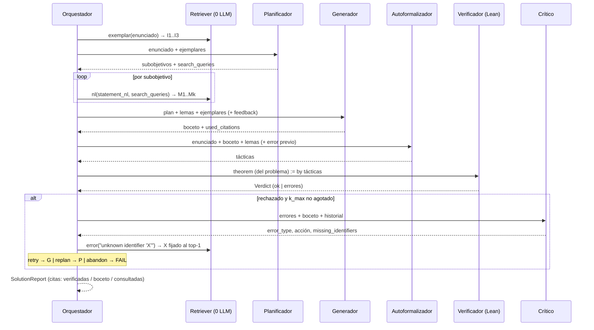

# Arquitectura de RagSolver (estado implementado)

Referencia de diseño: `PLAN_RAG.md` §5-§8; flujo por goal (por defecto desde `prompt_version: "2"`): `PLAN_MEJORA_RAG.md` §4; demostrador local (etapa 0): `PLAN_REDISENO_PROVER.md`. Este documento describe **lo que existe en el código** (estado del 2026-10-15, `prompt_version: "3"`), con los desvíos registrados en `DECISIONS.md` (#1-#115). Resumen de las mejoras de octubre: `Mejorasuwu.md`; diagramas del sistema actual: `diagramas.md`. La auditoría del 23-09 (`AUDIT_2026-09-23.md`, `PLAN_CORRECCIONES.md`) tiene cerradas las Fases 1-4.

## 1. Vista general

```mermaid
flowchart LR
  subgraph Orq["Orquestador — src/ragsolver/orchestrator/graph.py (LangGraph)"]
    PR["PROVE (etapa 0)\ndemostrador local, 0 API"] -- verifica --> V
    PR -- no resuelve --> P
    P[PLAN] --> R[RETRIEVE] --> G[GENERATE] --> F[FORMALIZE\nesqueleto con sorry] --> K[CLOSE\n0 LLM: premisas por goal + batería\n+ demostrador local para goals abiertos]
    K -- todos cerrados --> V[VERIFY]
    K -- goals abiertos --> FL[FILL\n1 llamada] --> V
    K -- esqueleto no elabora --> C
    V -- ok --> D[DONE]
    V -- error --> C[CRITIQUE]
    C -- retry --> G
    C -- retry + lema faltante --> R
    C -- replan --> P
    C -- abandon / k_max / presupuesto --> X[FAIL]
  end
  subgraph RAG["Módulo RAG — src/ragsolver/rag/"]
    IDX[(LanceDB\nmathlib · informal · figures)]
    RET[Retriever\nhíbrido + RRF + rerank + citas]
    ING1[ingest_mathlib] --> IDX
    ING2[ingest_informal\nMinerU + VLM] --> IDX
    IDX --> RET
  end
  subgraph Lean["Verificador — src/ragsolver/lean/verify.py"]
    REPL[LeanChecker\nREPL lean-interact · Mathlib v4.28.0-rc1]
  end
  subgraph GPU["Demostrador local — src/ragsolver/prover.py"]
    GP["Goedel-Prover-V2-8B Q6_K\nllama-server Vulkan · RX 9060 XT\n172.31.112.1:8082"]
  end
  LLM[ragsolver/llm.py\nGemini | OpenAI-compatible]
  P & G & F & C --> LLM
  PR & K --> GP
  PR -. sugerencias de nombres .-> RET
  R --> RET
  V --> REPL
  PR --> REPL
  Orq --> LOG[(traza JSONL\nun evento por agente/búsqueda)]
```

## 2. Componentes

| Componente | Módulo | Contrato | Costo LLM |
|---|---|---|---|
| Ingesta Mathlib | `rag/ingest_mathlib.py` | corpus LeanSearch v2 → `MathlibChunk` (`decl_name` = unión de componentes de `name`, #31) | 0 |
| Ingesta PDF | `rag/ingest_informal.py` (+ `mineru_blocks.py`, `figures.py`, `enrich.py`) | MinerU → huecos por capa de texto → QA de fórmulas → cards → figuras descritas → `InformalChunk`/`Figure` | offline (~230/documento, cacheadas) |
| Embeddings | `rag/embed.py` | Qwen3-Embedding-0.6B, documentos sin instrucción, consultas con instrucción por modo; bf16 en CPU | 0 |
| Índice | `rag/index.py` | LanceDB: vector + FTS (`_fts_text`) + prefiltro SQL; tablas `mathlib` (muestra 3 903), `mathlib_full` (278 160, ANN IVF_SQ con re-ranking exacto, #60), `informal`, `figures`; `RAGSOLVER_MATHLIB_TABLE` elige cuál sirve el corpus `mathlib` | 0 |
| Retriever | `rag/retrieve.py` | `RetrievalRequest → RetrievalResult` (§8); modos `nl/formal/error/exemplar`; citas `M*/I*` con localizador | **0** (RNF-3) |
| LLM | `llm.py` | `generate(prompt, schema, images, system)`; Gemini u OpenAI-compatible (OpenRouter con tope de precio, servidor local); cadena de modelos por cuota; tokens y costo exacto por llamada; sin reintentos por JSON inválido (el único reintento lo hace el agente, #59) | 1 por llamada |
| Demostrador local | `prover.py` (`LocalProver`, `prove`, `goal_to_theorem`), nodo `prove` y `Orchestrator._prove_goal`, caché `data/eval/prover_cache.jsonl`, config `configs/agents.yaml: prover` | Goedel-Prover-V2-8B (Apache-2.0) Q6_K servido por `llama-server` Vulkan (8 slots × 12 288, KV q8_0; ~45 tok/s por muestra, ~70 agregados). **Etapa 0**: teorema completo → hasta `k_root` = 8 muestras en lotes de 4 con salida temprana; de cada una se toman sólo las tácticas del teorema pedido y se empalman en el enunciado del problema; cada candidato pasa por `LeanChecker.check`. Si ninguna verifica, 1 ronda de autocorrección sobre las 2 mejores con los errores de Lean + nombres sugeridos por el RAG. **En CLOSE**: los goals que la batería no cierra se piden como lemas autónomos (`goal_to_theorem`, `rename_i` para nombres inaccesibles), `k_goal` = 2, `max_goals` = 2 por intento | **0 API** (GPU local); muestras en caché de disco compartida por `full` y `baseline_prover` |
| Agentes | `agents/agents.py`, contratos `agents/schemas.py`, prompts `configs/agents.yaml` | Planificador, Generador, Autoformalizador (sólo tácticas), Crítico, FILL; líneas base A/B | 1 cada uno |
| Verificador | `lean/verify.py` | `LeanChecker.check(enunciado, tácticas) → Verdict`; el enunciado se empalma desde el problema (#40); tácticas validadas (SEC-1) y axiomas auditados (VER-1) antes de aceptar — §6 | 0 |
| Premisas por goal | `rag/premises.py`, `orchestrator/graph.py::select_premises` | goal de Lean (REPL) → canal A prior de competición (`data/corpus/premise_prior.jsonl`, `scripts/build_premise_prior.py`) filtrado por los símbolos del goal (el canal C, índice denso con la meta del goal, está **apagado**: recall@16 0.028 y hunde la fusión, #98); canal B (selección nativa de Lean) se consume en CLOSE con `grind +suggestions` | 0 |
| CLOSE / FILL | `orchestrator/graph.py::close_goal`, nodos `close`/`fill`; `LeanChecker.goals`/`step` | `goals`: el esqueleto se elabora en modo sonda (nunca da `ok`) y devuelve un goal + `proof_state` por `sorry`; `step`: `ProofStep` validado por `find_forbidden_tactic`; batería `configs/agents.yaml: close.tactics` (la primera que cierra gana; `try?` → script concreto); FILL sólo ve los goals abiertos; `proved` conserva los goals cerrados entre intentos y replans | CLOSE 0, FILL 1 |
| Orquestador | `orchestrator/graph.py`, runner `orchestrator/run.py` | estado con `evidence`, presupuesto ≤ 20 llamadas, `SolutionReport` con citas verificadas/usadas/consultadas y `solved_by` (`prover_root` / `agents`) + `prover_samples`; salida inválida persistente = fallo del intento dentro del grafo (#61); Crítico o FILL ilegibles no matan el problema (#110); runner con hilos (`--workers`), reanudable y con reintento de filas `error` (#50, #58). Configuraciones: `full`, `no_rag`, `no_critic`, `rag_nl`, `baseline_auto` (0 LLM), `baseline_prover` (0 API), `baseline_a`, `baseline_b` | — |
| Traza | `logging/jsonl_writer.py` | `TraceEvent` por (problema, agente, intento), versiones fijadas (RNF-2/5) | — |

## 3. Flujo por problema (implementado)

**Etapa 0 (por defecto, `prover.enabled: true`).** Antes de planificar, el nodo `prove` le pide al demostrador local el teorema completo: `k_root` = 8 muestras en lotes de 4 (la primera que verifica gana), y si ninguna, una ronda de autocorrección. Si resuelve, el grafo salta a VERIFY (`solved_by = prover_root`) sin una sola llamada a la API; si no, sigue el flujo de abajo, y el demostrador reaparece en CLOSE para los goals que la batería no cierra. En la autocorrección, ante `unknown identifier/constant X` el RAG (modo `error`) busca declaraciones parecidas, las valida con `#check` contra el Mathlib fijado y sólo pasa al modelo nombres que existen (el modelo se entrenó con Lean 4.9; el verificador es v4.28). Esas sugerencias se registran como citas `M*`; `used_in_proof` mide si el término aceptado las usó.




Con `goal_mode: true` (por defecto; `rag_nl` es el flujo de `eval_v1`), los pasos 2 y 4 cambian:
RETRIEVE ya no consulta Mathlib con lenguaje natural; FORMALIZE escribe un esqueleto `have … := by sorry`;
CLOSE recupera premisas **por goal** y prueba la batería (0 LLM); FILL (1 llamada) cierra los goals restantes;
el archivo final se arma con `fill_sorries` y pasa por VERIFY igual que antes. En un replan, el Planificador
recibe el feedback del Crítico, su estrategia anterior y los goals ya probados (DES-1).

1. **PLAN**: recuperación de ejemplares en el corpus informal (`mode=exemplar`, k=3, 0 llamadas) → Planificador (1 llamada) → subobjetivos con `search_queries` y `math_area`.
2. **RETRIEVE**: por subobjetivo, `queries = [statement_nl] + search_queries` en Mathlib (`k=8`, RRF, sin rerank por RAM — #40); si el Crítico dejó `missing_identifiers`, búsqueda `mode=error` (identificador exacto fijado al top-1). Las citas se acumulan en `evidence`.
3. **GENERATE** (1 llamada): boceto + `used_citations`.
4. **FORMALIZE** (1 llamada): sólo el bloque de tácticas; el archivo Lean se arma con el `theorem` del problema.
5. **VERIFY** (0 llamadas): REPL de Lean con `import Mathlib`; tácticas validadas y axiomas auditados antes de aceptar (§6).
6. **CRITIQUE** (1 llamada si hay Crítico): `error_type` ∈ {lean_syntax, missing_lemma, misformalization, timeout, planning, unknown}, acción retry/replan/abandon.
7. Presupuesto: 3 llamadas por intento + 1 por crítica + 1 por plan → con `k_max=3` ≈ 12-13 ≤ 20.

## 4. Citación (§6.4)

`used_in_proof`: el `decl_name` aparece en el código aceptado por el kernel (mecánico). `used_in_sketch`: declarado por el Generador. Consultadas: todo lo recuperado. Localizadores: Mathlib `{decl_name, module_path, docs_url}`; informal `{doc_id, page_start, page_end, item_number, figure_ids}` + figuras adjuntas `{figure_id, image_path, description, ...}`.

## 5. Datos y versiones

`configs/versions.yaml` fija Lean/Mathlib (`v4.28.0-rc1`), embedder, reranker, parser, proveedor LLM e índice; cada evento de traza copia el pin (incluida la tabla `mathlib` servida). Corpus y tablas en `data/` (no versionados en git); la caché de Mathlib compilada vive en `~/ragsolver_cache/lean_project` (#35). El modelo del demostrador (GGUF `mradermacher/Goedel-Prover-V2-8B-GGUF`, rev. `43fab68e`, Q6_K) vive en `tools/models/` y se sirve con `tools/llama-vulkan/llama-server.exe` lanzado desde WSL (ver `Mejorasuwu.md` §8); la caché de muestras en `data/eval/prover_cache.jsonl`. El prior de competición está en `data/corpus/premise_prior.jsonl`.

## 6. Modelo de amenazas del verificador (docs/AUDIT_2026-09-23.md SEC-1/VER-1, docs/PLAN_CORRECCIONES.md Fase 1)

Las tácticas que verifica el kernel las escribe un LLM que puede venir de un proveedor no confiable (#62 enruta a varios proveedores de OpenRouter) o estar contaminado por un corpus de terceros (prompt injection vía documentos ingeridos). `lean/verify.py` sigue los niveles de la [guía oficial de Lean para validar pruebas](https://lean-lang.org/doc/reference/latest/ValidatingProofs/):

- **Nivel 1 — validación de tácticas** (`find_forbidden_tactic`, antes de tocar Lean): rechaza `#comando` (en cualquier posición, no sólo al inicio de línea — `open X in #eval ...` es sintaxis válida), metaprogramación (`run_tac`, `macro`, `elab`, `notation`…), declaraciones nuevas (`theorem`, `def`, `axiom`…), cambios de entorno (`set_option`, `import`, `open` salvo `open X in`) y caminos que evitan el kernel (`sorry`, `native_decide`, `decide +native`, `IO.*`). **Confirmado empíricamente** (docs/PLAN_CORRECCIONES.md Fase 1, tarea 7): antes de este cambio, `simp\n#eval IO.println "..."` empalmado como una prueba normal **ejecutaba** el comando inyectado.
- **Nivel 2 — auditoría de axiomas** (`#print axioms <nombre>`, tras un veredicto sin errores): `ok=true` exige que los axiomas usados sean un subconjunto de `propext`, `Classical.choice`, `Quot.sound`. Sin esto, `decide +native` — que el kernel **acepta** — pasaría como "verificado" dependiendo de `Lean.ofReduceBool`/`Lean.trustCompiler` (evaluación del compilador, no del kernel); es el mismo fallo que afectó a [15/225 soluciones publicadas de Kimina-Prover](https://github.com/MoonshotAI/Kimina-Prover-Preview/issues/11).
- **`lean_code` fiel a lo verificado** (BUG-2): `theorem_block`/`build_file` son la única fuente para el REPL y para el reporte — no pueden divergir.
- **El demostrador local no cambia el modelo de amenazas** (`prover.py`): del texto del modelo se extraen **sólo las tácticas** del teorema pedido y se empalman en el enunciado del problema (no puede debilitarlo); cada candidato pasa por el mismo `LeanChecker.check` (validador de tácticas → kernel → auditoría de axiomas) y los bloques para goals por `LeanChecker.step` con `find_forbidden_tactic`. Un servidor `llama-server` escuchando fuera de la red virtual WSL↔Windows sí ampliaría la superficie (SEC-3): hoy sólo escucha en `172.31.112.1`.

**Lo que esto NO cubre todavía** (Fase 10 de `docs/PLAN_CORRECCIONES.md`, con disparador): no hay sandbox de sistema operativo — un bug del propio elaborador de Lean, o una táctica válida pero que agote CPU/disco (el `maxHeartbeats` sólo limita pasos de elaboración), no está contenido. Antes de exponer la demo fuera de `localhost`, de procesar corpus de terceros sin revisar, o de cambiar a un proveedor LLM no confiable, corresponde el sandbox de sistema operativo (`bwrap` envolviendo `lake_path` de `lean-interact`, ya viable en esta máquina — verificado `/usr/bin/bwrap` presente en WSL2).

Re-verificación offline de `eval-v1` con este verificador (`scripts/reverify_eval_v1.py`, 0 llamadas LLM): **27/27 pruebas antes aceptadas siguen aceptadas, 0 regresiones**, todas con axiomas estándar (DECISIONS #69).
