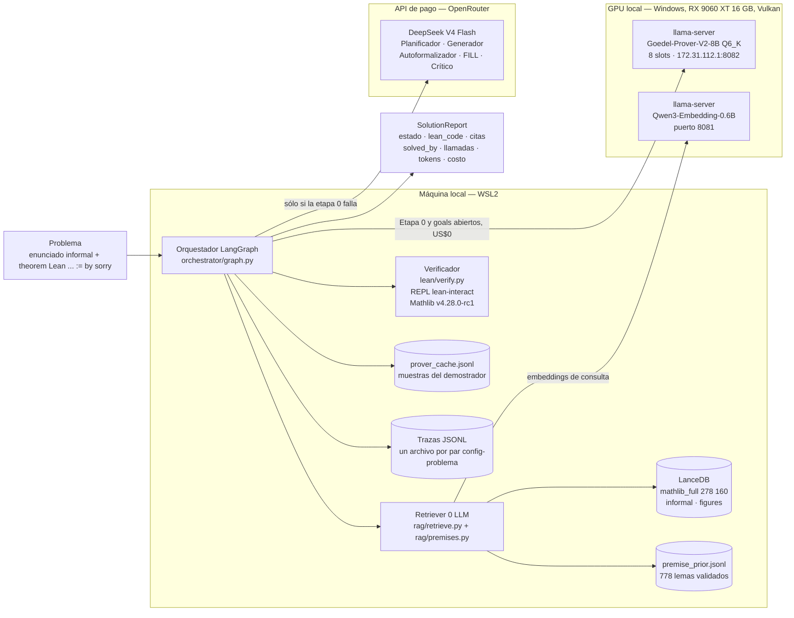
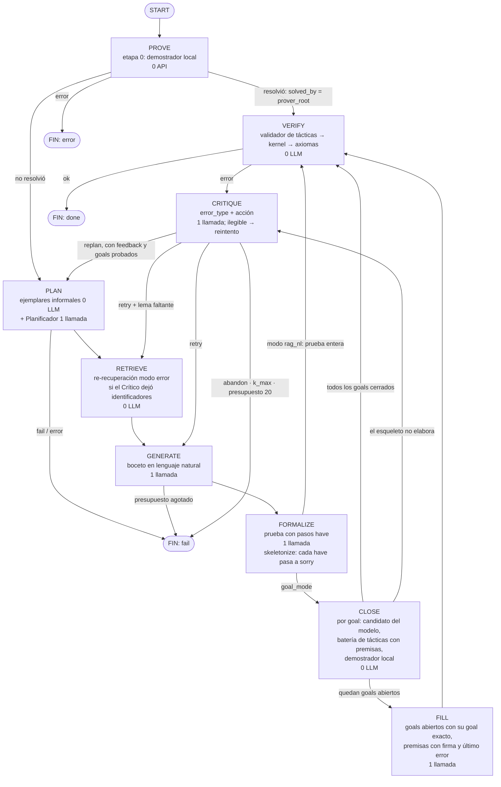
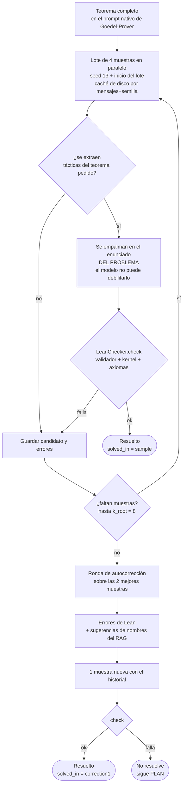
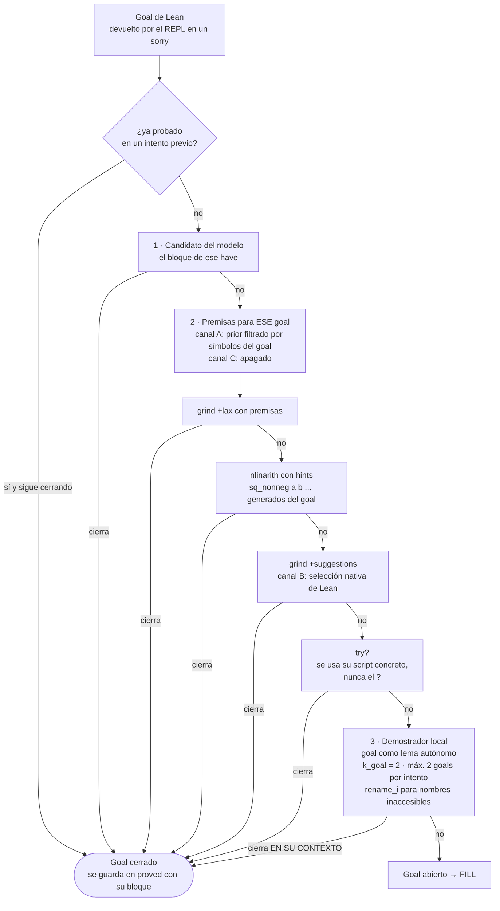
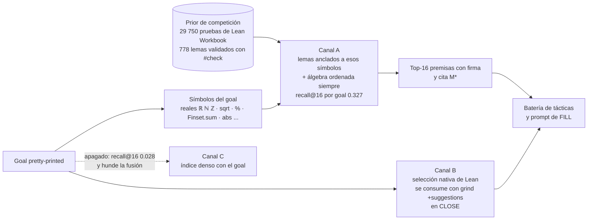
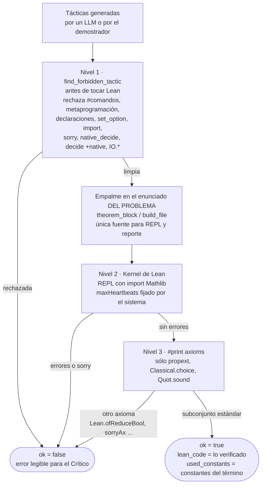
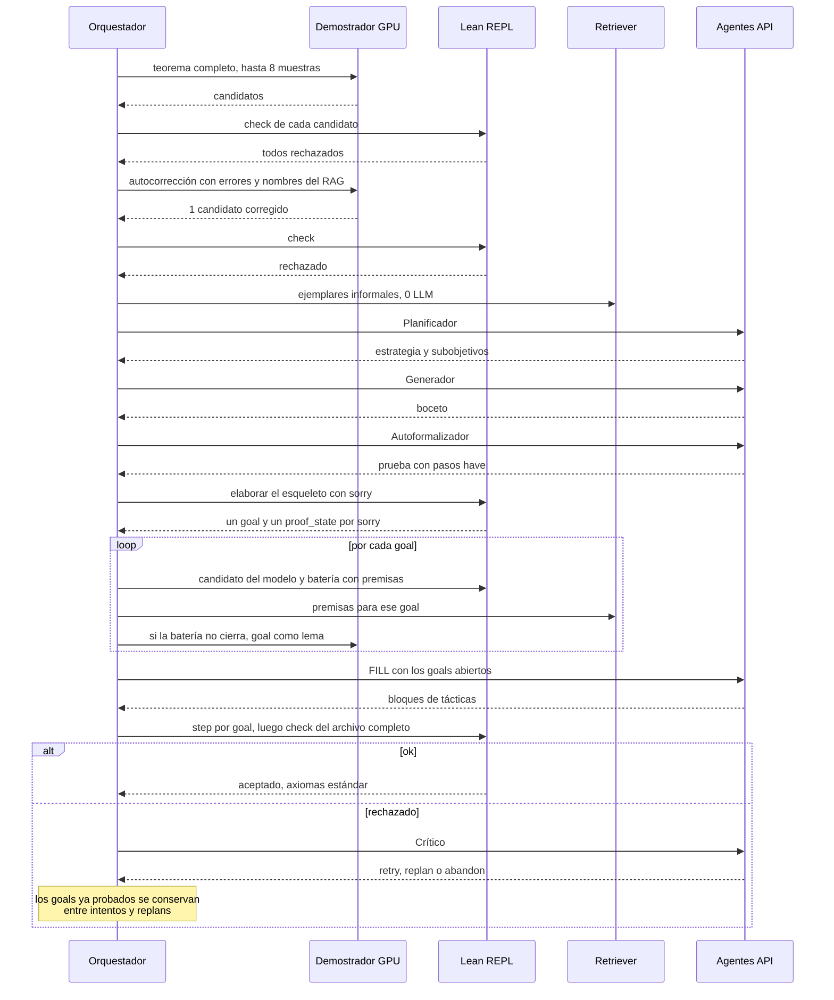
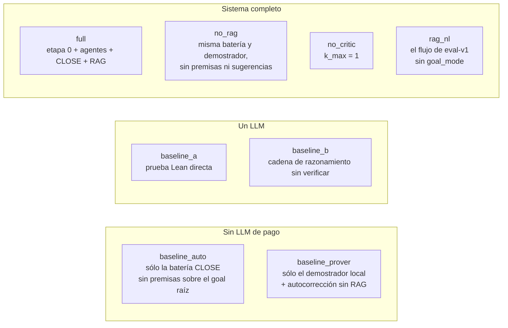
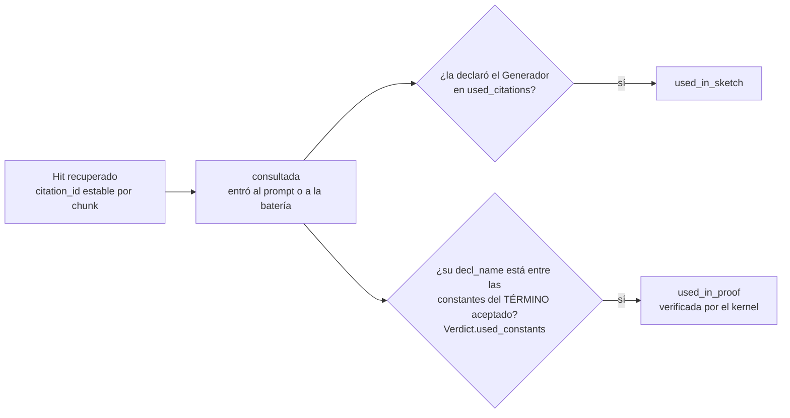

# Diagramas del sistema actual (RagSolver, 2026-10-18)

Estado: `prompt_version: "3"`, demostrador local activado (`prover.enabled: true`), `goal_mode: true`. Fuente: `src/ragsolver/orchestrator/graph.py` (aristas de `build`), `prover.py`, `lean/verify.py`, `configs/agents.yaml`. Texto de apoyo: `architecture.md` (componentes y contratos) y `Mejorasuwu.md` (qué cambió y por qué). Resultado medido: 21/30 en eval-v3 frente a 8/30 del sistema anterior (`eval_report_v3.md`).

Los diagramas son Mermaid: se ven en GitHub, VS Code (extensión Markdown Preview Mermaid) y en la mayoría de visores de Markdown.

## 1. Vista general

Quién habla con quién. Todo lo que cuesta dinero (API) está en el borde derecho; el resto es local.



## 2. Grafo del orquestador (aristas reales)

Nodos y condiciones tal como están en `Orchestrator.build`. Un nodo que lanza una excepción termina en `status = error` sin perder la contabilidad (`_guard`, #84).



Presupuesto de llamadas (RNF-3, ≤ 20): Planificador 1 + por intento Generador 1, Autoformalizador 1, FILL 0-1, Crítico 1 (con `k_max = 3` el peor caso ronda 13). PROVE, CLOSE, RETRIEVE y VERIFY cuestan 0 llamadas a la API.

## 3. Etapa 0: demostrador local (`prover.prove`)



### 3.1 Rol del RAG dentro de la autocorrección

El demostrador se entrenó con Lean 4.9; el verificador es v4.28, así que a veces usa lemas renombrados o borrados.

```mermaid
sequenceDiagram
  participant P as Demostrador
  participant L as Lean REPL
  participant R as Retriever modo error
  P->>L: pruebas candidatas
  L-->>P: unknown identifier "Nat.foo_bar"
  Note over P,L: autocorrección
  P->>R: nombre desconocido
  R->>R: búsqueda léxica + densa en mathlib_full
  R->>L: #check de cada candidato
  L-->>R: sólo los que existen, con su firma
  R-->>P: "Nat.foo_baz : ..." existe; "Nat.foo_bar" no existe
  P->>L: prueba corregida
  L-->>P: veredicto
  Note over R: las sugerencias entran como citas M*;<br/>used_in_proof mide si el término aceptado las usó
```

## 4. CLOSE: un goal, de menos a más costoso

Cada paso es una llamada a `LeanChecker.step` sobre el `proof_state` del goal (sin re-elaborar el teorema). Cada táctica pasa por `find_forbidden_tactic`.



`no_rag` corre la misma escalera sin premisas, sin hints y sin `grind +suggestions` (columna `plain` de `close.tactics`), de modo que la ablación aísla el efecto del RAG del de la automatización de Lean.

## 5. Recuperación de premisas por goal



Contrasto con el sistema original: consulta en lenguaje natural sobre el índice denso → recall 0.006 por problema; consulta con el goal sobre el prior → 0.229 por problema.

## 6. Verificación: ¿qué significa "resuelto"?



No cubierto todavía (Fase 10 de `PLAN_CORRECCIONES.md`): sandbox de sistema operativo; el servidor del demostrador sólo escucha en la red virtual WSL↔Windows.

## 7. Secuencia de un problema difícil

El caso en que la etapa 0 no basta y entran los goals y los agentes.



## 8. Configuraciones de evaluación



| Configuración | LLM de pago | Qué responde |
|---|---|---|
| `full` | sí (respaldo) | sistema completo |
| `baseline_prover` | no | cuánto resuelve el demostrador solo |
| `full` − `baseline_prover` | — | qué suman agentes y RAG sobre el demostrador (0 en eval-v3) |
| `full` − `no_rag` | — | aporte del RAG con la automatización fija |
| `full` − `baseline_auto` | — | aporte de los agentes sobre Lean solo |
| `baseline_a` / `baseline_b` | sí, 1 llamada | líneas base de la propuesta (§8.2) |

## 9. Datos y construcción offline

```mermaid
flowchart TD
  subgraph FORMAL["Corpus A · Mathlib"]
    LS["LeanSearch v2 JSONL\n310 579 declaraciones"] --> NORM["ingest_mathlib\n278 160 chunks"]
    NORM --> E1["Embeddings Qwen3-0.6B\nGPU Vulkan, 4.5 h"]
    E1 --> T1[("mathlib_full\nvector + FTS + ANN IVF_SQ")]
    NORM --> SM[("mathlib\nmuestra de 3 903 filas")]
  end
  subgraph PRIORB["Prior de competición"]
    LW["Lean Workbook proofs\n29 750 pruebas, MIT"] --> CNT["frecuencia por lema"]
    CNT --> VAL["validación con #check\nen el Lean fijado"]
    VAL --> PJ[("premise_prior.jsonl\n778 lemas")]
  end
  subgraph INFORMAL["Corpus B · PDF de olimpiadas"]
    PDF["PDF"] --> MIN["MinerU local"]
    MIN --> GAP["huecos de layout\ncapa de texto vs bloques"]
    GAP --> VLM["VLM: huecos · fórmulas · figuras · resúmenes\ncaché por llamada"]
    VLM --> CARDS["100 problem cards + 53 figuras"]
    CARDS --> T2[("informal · figures")]
  end
  subgraph EVAL["Evaluación"]
    MQ["MathlibQR / MPR"]
    GOLD["Premisas gold por problema y por goal\nvalidadas contra Lean"]
    PB["miniF2F-v2\neval_v1: 60 problemas, 3 áreas × 3 niveles"]
  end
```



## 10. Citas: qué cuenta como "ayudó"



En eval-v2 el kernel usó 1 premisa recuperada; en eval-v3, 0 de las 8 sugerencias de nombres.

## 11. Dónde está cada cosa

| Qué | Dónde |
|---|---|
| Grafo, CLOSE, FILL, replan, `solved_by` | `src/ragsolver/orchestrator/graph.py` |
| Demostrador local, `goal_to_theorem`, caché | `src/ragsolver/prover.py` |
| Verificador, `goals`, `step`, `skeletonize`, `fill_sorries` | `src/ragsolver/lean/verify.py` |
| Premisas por goal | `src/ragsolver/rag/premises.py`, `data/corpus/premise_prior.jsonl` |
| Retriever | `src/ragsolver/rag/retrieve.py` |
| Ejecución de evaluaciones, líneas base | `src/ragsolver/orchestrator/run.py` |
| Prompts, batería, demostrador, configuraciones | `configs/agents.yaml` |
| Versiones fijadas | `configs/versions.yaml` |
